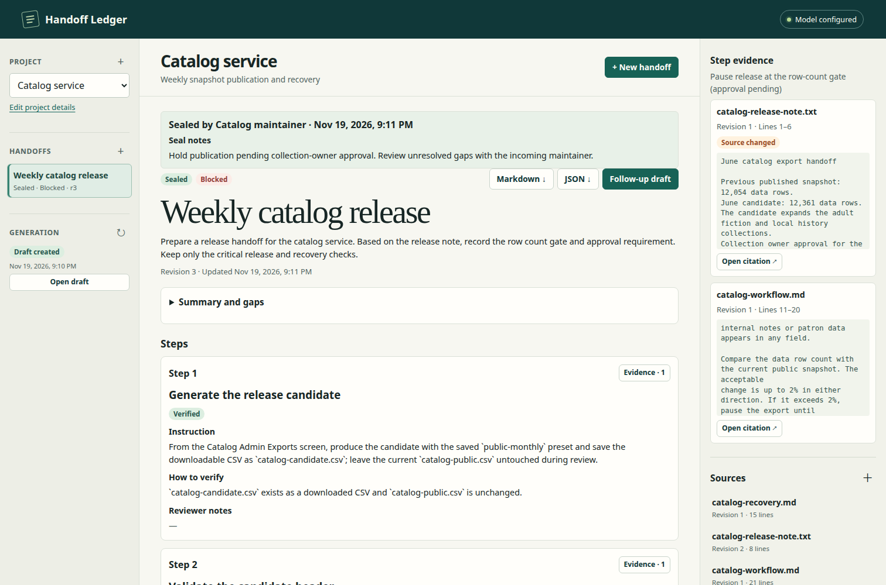

# Handoff Ledger

[简体中文](README.zh-CN.md) · [Releases](https://github.com/iyuzhang/handoff-ledger/releases)

Handoff Ledger turns operational notes into reviewable checklists. Import source documents, draft a handoff with an optional language model, and check each step against the source revision and line numbers it cites. When review is complete, seal the record and export it as Markdown or JSON.

Use it for work that someone else must be able to repeat or take over, such as a recurring data release, a maintenance window, or an ownership transfer.



- **Source history.** Pin exact line ranges to steps. Edit or archive a source and keep earlier revisions available. Quotes retain the original text, with a stale indicator when the underlying source changes.
- **Review and sign-off.** Mark each step verified or blocked and record what you observed. A sealed record captures who reviewed it and whether the handoff was ready or blocked. Use a follow-up draft to repeat the review against updated information.
- **Local workspace.** Projects, source revisions, and review records live in SQLite. Manual drafting, review, and export work without a model.

## Install and start

With Python 3.11 or later, download the wheel from the [latest release](https://github.com/iyuzhang/handoff-ledger/releases/latest) and run these commands from the download directory.

```sh
python3 -m venv .venv
. .venv/bin/activate
python -m pip install ./handoff_ledger-*-py3-none-any.whl
handoff-ledger serve
```

On Windows PowerShell, activate the environment with `.venv\Scripts\Activate.ps1` and pass the downloaded wheel's full filename to `python -m pip install`.

For a checkout with [uv](https://docs.astral.sh/uv/getting-started/installation/) installed, use these commands.

```sh
git clone https://github.com/iyuzhang/handoff-ledger.git
cd handoff-ledger
uv sync --locked
uv run --locked handoff-ledger serve
```

For Docker Compose, use the same checkout and run `docker compose up -d --build`. Open [http://127.0.0.1:8080](http://127.0.0.1:8080) with either installation. The [operations guide](docs/operations.md) covers configuration, backups, and upgrades.

## Review a first handoff

1. Create a project and add the three files in [the catalog example](examples/) as separate sources. Each file contains plain text and can be pasted directly.
2. Create a draft with the goal “Decide whether the June catalog snapshot is ready to release, and document the recovery procedure.” For model drafting, select all three sources. For manual drafting, add a step to check the candidate row count against the threshold and record the approval status.
3. Read the cited source revisions. For a manual step, pin the relevant lines from the workflow and release note. The example's candidate has 12,361 rows versus 12,054 previously, a 2.55% change. The documented limit is 2%, and the collection owner's approval is pending. Mark the release gate blocked and record the reason.
4. Add your reviewer name and review notes, then seal the handoff. Download the Markdown version for a person or the JSON version for downstream processing.

To repeat the review, revise the release note to reflect a new approval decision and choose **Follow-up draft** on the sealed record. The new draft retains the steps, resets their review statuses, and links to the original. Check the stale citations, update their line references, and record the new outcome.

## Enable model drafting

Set the server environment before launching or restarting Handoff Ledger.

```sh
export LLM_BASE_URL="https://your-provider.example/v1"
export LLM_MODEL="your-provider-model"
read -rs LLM_API_KEY
export LLM_API_KEY
```

Use your provider's OpenAI-compatible Chat Completions base URL and model identifier. The base URL usually ends in `/v1`. Skip the key setup for an endpoint that requires no authentication. If the endpoint rejects JSON mode, set `LLM_JSON_MODE=0`. Start the app using the same method as above.

Submitting a generation request sends the title, goal, and complete text of the selected source revisions to the configured provider. Check what you select and follow your provider's data-handling rules. A model-backed draft requires human review, and its instructions are for people to perform.

## Contributing

Run `uv sync --locked` and `uv run --locked handoff-ledger serve` to work from source. Please use synthetic inputs for bug reports and examples. See [SECURITY.md](SECURITY.md) for private vulnerability reports.

[MIT License](LICENSE)
