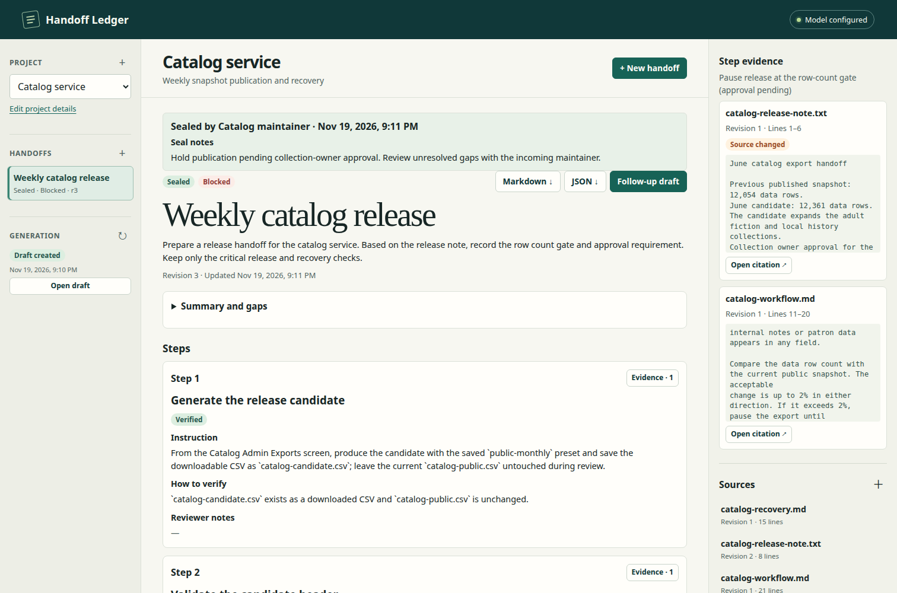

# Handoff Ledger

[English](README.md) · [发行版本](https://github.com/iyuzhang/handoff-ledger/releases)

Handoff Ledger 把操作文档、交接笔记和事故记录整理成可复核的清单。你可以手写交接草稿，也可以让模型根据所选资料起草。逐项对照原始版本与行号核验后，封存交接记录，并导出 Markdown 或 JSON。

适合重复的数据发布、维护值班和负责人变更等需要另一人接手的工作。



- **追溯来源。** 为步骤固定明确的行号范围。编辑或归档来源后，仍可打开旧版本。引用保留原文片段，来源后续发生变化时会标示为过期。
- **明确审核结果。** 逐项记录验证结果和阻塞原因，封存时保留审核人及交接状态。情况变化后，可从封存记录发起后续复核。
- **本地保存。** 项目、文档版本和审核记录保存在 SQLite。手写、审核和导出可在无模型配置的情况下使用。

## 安装与启动

使用 Python 3.11 或更高版本，从[最新发行版](https://github.com/iyuzhang/handoff-ledger/releases/latest)下载 wheel，然后在下载目录执行。

```sh
python3 -m venv .venv
. .venv/bin/activate
python -m pip install ./handoff_ledger-*-py3-none-any.whl
handoff-ledger serve
```

在 Windows PowerShell 中，使用 `.venv\Scripts\Activate.ps1` 激活环境，并给 `python -m pip install` 传入下载的 wheel 完整文件名。

也可以安装 [uv](https://docs.astral.sh/uv/getting-started/installation/) 后从源码运行。

```sh
git clone https://github.com/iyuzhang/handoff-ledger.git
cd handoff-ledger
uv sync --locked
uv run --locked handoff-ledger serve
```

使用 Docker Compose 时，在同一源码目录运行 `docker compose up -d --build`。启动后访问 [http://127.0.0.1:8080](http://127.0.0.1:8080)。部署、备份和升级细节见[运维指南](docs/operations.md)。

## 复核第一份交接

1. 创建项目，将[馆藏目录发布样例](examples/)中的三个文件分别添加为来源。每个文件都可作为纯文本粘贴。
2. 创建交接草稿，目标可填写“判断 6 月馆藏目录是否能发布，并记录回退流程”。使用模型时选择这三个来源。手写时添加一个步骤，用来检查行数变动是否超过阈值，并记录负责人是否已批准。
3. 打开引用的来源版本。为手写步骤固定发布流程与发布说明中的相应行号。样例中的候选文件有 12,361 行，原版本有 12,054 行，变动为 2.55%。文档规定阈值是 2%，且负责人尚未批准。因此可以把发布步骤标为阻塞，并记录原因。
4. 填写审核人和审核说明，封存交接。Markdown 适合交给接手的人，JSON 适合供其他系统读取。

收到新的审批决定后，可以更新发布说明，并在已封存的交接中选择 **Follow-up draft**。新草稿关联原记录，保留步骤并重置其审核状态。检查标为过期的引用，更新行号引用，然后记录本次复核的结果。

## 配置模型

在启动或重启服务前设置环境变量。

```sh
export LLM_BASE_URL="https://your-provider.example/v1"
export LLM_MODEL="your-provider-model"
read -rs LLM_API_KEY
export LLM_API_KEY
```

使用服务商提供的 OpenAI 兼容 Chat Completions 基础 URL 和模型 ID。基础 URL 通常以 `/v1` 结尾。无鉴权的本地服务可省略密钥。若服务端不支持 JSON mode，可以设置 `LLM_JSON_MODE=0`。按前文对应的安装方式启动应用。

主动提交生成任务时，应用会把标题、目标以及所选来源当前版本的全文发送给配置的模型服务。请按服务商的数据规则选择资料。模型生成的是待审核草稿，清单步骤由操作人员执行。

报告问题请使用合成数据，私下报告安全问题见 [SECURITY.md](SECURITY.md)。

[MIT 许可证](LICENSE)
